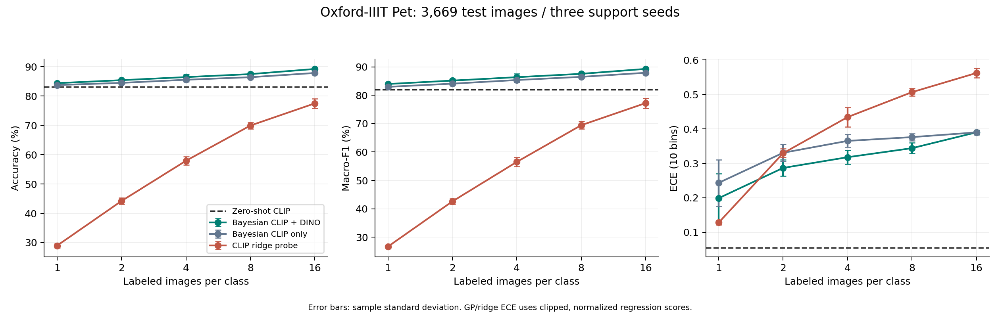
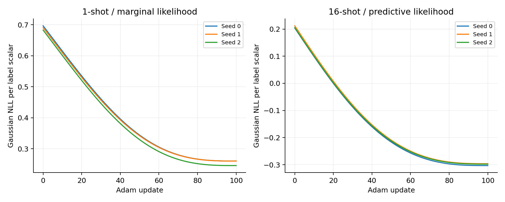
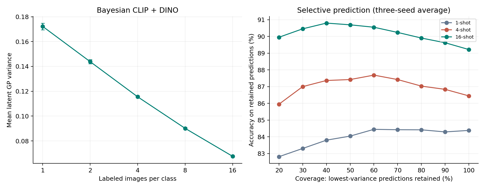

Bayesian Exploration of Pre-trained Models

| Field | Value |
|---|---|
| Algorithm | Bayesian Exploration of Pre-trained Models for Low-shot Image Classification, CVPR 2024 |
| Authors | Yibo Miao, Yu Lei, Feng Zhou, and Zhijie Deng |
| Experiment date | October 10, 2026 |
| Source-code webpage | [yuannnnn1/Bayesian-Exploration](https://github.com/yuannnnn1/Bayesian-Exploration) |
| Git clone URL | [https://github.com/yuannnnn1/Bayesian-Exploration.git](https://github.com/yuannnnn1/Bayesian-Exploration.git) |

## Overview

This assignment implements a Bayesian classifier using frozen pre-trained encoders. CLIP supplies a zero-shot prior mean, while CLIP and DINO features define a Gaussian-process (GP) covariance kernel. One-hot class labels are regression targets, giving an analytical posterior mean and variance.

On Oxford-IIIT Pet, the CLIP+DINO GP reaches **89.22% +/- 0.28% accuracy at 16-shot**, compared with **83.13%** for zero-shot CLIP. Under the explicit probability mapping used here, its categorical NLL and calibration error are worse than the zero-shot baseline. The study demonstrates an accuracy benefit without claiming that all uncertainty or calibration findings of the paper have been reproduced.

All local results come from [experiment.json](results/experiment.json), [summary.csv](results/summary.csv), and [experiment.log](results/experiment.log), not from the paper's published tables.

## 1. How AI Found and Selected the Algorithm

### 1.1 Interpreting the assignment

AI interpreted the requirements as seeking a recent image-classification or recognition algorithm whose main mechanism depends on probability or Bayesian theory. A softmax output alone would not establish a Bayesian contribution. The implementation also needed to be practical on the local computer and produce reproducible evidence for a Markdown report.

The screening criteria were a verifiable recent publication, explicit prior/likelihood/posterior modeling, accessible pre-trained models and data, a sufficiently specified method, and modest local computation. These criteria translate into searches combining "Bayesian", "Gaussian process", "pre-trained models", and "low-shot image classification".

The selected paper was verified against its [official CVPR page](https://openaccess.thecvf.com/content/CVPR2024/html/Miao_Bayesian_Exploration_of_Pre-trained_Models_for_Low-shot_Image_Classification_CVPR_2024_paper.html) and [arXiv manuscript](https://arxiv.org/html/2404.00312v1). The publication page confirms the title, authors, year, and pages 23849-23859. The manuscript provides the formulas and training protocol.

A complete ranked browser-search history was not retained in the workspace. This report therefore states the selection criteria and verified sources without inventing historical search queries, search counts, or experiments on rejected candidates.

### 1.2 Comparing implementation approaches

This comparison explains the selection rationale; it is conceptual, not a benchmark of these alternatives.

| Approach | Probabilistic foundation | Implementation and data requirements | Decision |
|---|---|---|---|
| Zero-shot CLIP | Categorical scores; no label-conditioned Bayesian posterior in this baseline | Frozen model and class descriptions | Useful baseline, insufficient as the main Bayesian algorithm |
| Bayesian neural-network fine-tuning | Distribution over parameters, often with approximate inference | Many parameters and potentially costly fine-tuning | Plausible alternative, harder to validate locally |
| GP with frozen deep features | Function-space prior and exact Gaussian posterior | Small support set; matrix cost depends on support count | Tractable Bayesian foundation |
| Selected CVPR 2024 method | CLIP mean plus summed pre-trained deep kernels | A few hyperparameters on top of frozen encoders | Selected for its recent contribution and practical exact inference |

The relevant contribution is the integration of complementary pre-trained knowledge into both GP mean and covariance. The user accepted this method after the comparison stage.

### 1.3 Implementation provenance

No author-maintained implementation was identified during this project. The verified CVPR page links the paper, supplement, and arXiv manuscript, but not source code. This does not prove that no author implementation exists elsewhere.

The GP code was independently implemented from the formulas. [OpenCLIP](https://github.com/mlfoundations/open_clip) supplies CLIP; [DINO](https://github.com/facebookresearch/dino) supplies the second image encoder. The user's GitHub repository is the assignment's destination, not the paper authors' repository.

## 2. Algorithm Description

### 2.1 Bayesian label regression

For n support images and C classes, labels are C-dimensional one-hot vectors. The model uses C independent GP regression outputs with a shared covariance:

$$
f_c(x)\sim\mathcal{GP}(m_c(x),k(x,x')), \qquad
y_c\mid f_c(x)\sim\mathcal{N}(f_c(x),\sigma^2).
$$

Image encoders remain frozen. Only a few mean and kernel hyperparameters are optimized. Applying a Gaussian likelihood to one-hot labels preserves conjugacy and exact inference, but does not directly yield a categorical posterior over classes.

### 2.2 CLIP prior mean

Let s(x) be the cosine similarities between a normalized CLIP image embedding and normalized class-text embeddings. Equation 8 of the paper gives:

$$
m(x)=\gamma\,\operatorname{softmax}(\tau s(x)).
$$

Tau is a positive logit scale, named "temperature" in the implementation, and gamma is a positive prior scale. Since gamma can differ from 1, the GP mean need not sum to 1. The local prompt is "a photo of a {lowercase_class_name}". Initial tau=100 and gamma=1 preserve CLIP's zero-shot knowledge.

### 2.3 Additive deep kernel

For each normalized image feature vector phi_i(x), the implementation uses one scalar lengthscale per encoder:

$$
k_i(x,x')=\exp\left(-\frac{\|\phi_i(x)-\phi_i(x')\|_2^2}{2\ell_i^2}\right),
\qquad k(x,x')=\sum_i k_i(x,x').
$$

The main model sums OpenCLIP RN50 and DINO ResNet-50 kernels. The ablation omits DINO. The paper also allows feature-wise scaling; scalar lengthscales are a local simplification.

Each normalized RBF kernel has diagonal 1. The summed prior variance is therefore 2 for the two-encoder model and 1 for the ablation. Raw variances across these models are not directly comparable calibration scores.

### 2.4 Exact posterior

Let Y contain the support labels, M the support prior means, and M_* the test prior means. With A=K+sigma^2 I:

$$
\mu_*=M_*+K_{*X}A^{-1}(Y-M), \qquad
\Sigma_*=K_{**}-K_{*X}A^{-1}K_{X*}.
$$

The predicted class is the largest component of the posterior mean. The diagonal of the latent covariance is an uncertainty score shared across output classes for each image; it excludes observation noise.

The code uses float64 Cholesky factorization, triangular solves, and numerical jitter 1e-8. It avoids explicit inversion and computes only the required covariance diagonal rather than a full test-test matrix.

### 2.5 Hyperparameter fitting

The parameters are lengthscales, noise variance, CLIP logit scale, and prior scale. Log-parameterization enforces positivity. For 1-shot, Gaussian marginal likelihood is optimized on all support samples. For higher shot counts, each class's support is split 1:1 into fit/validation and the full joint Gaussian predictive likelihood is optimized.

There are 100 Adam updates, initial learning rate 0.01 with cosine decay, initial lengthscales 1, and initial noise variance 0.01. The lowest-loss parameter state is retained. The final posterior uses all support samples. No additional support labels or test labels are used for tuning.

## 3. How AI Implemented the Algorithm

### 3.1 Environment and feature preparation

The recorded runtime is macOS 26.6.2, arm64, Python 3.9.6, and PyTorch 2.8.0. MPS was unavailable in this runtime; the benchmark used CPU with four PyTorch threads. Downloads were performed after user confirmation.

| Dependency | Version |
|---|---|
| PyTorch | 2.8.0 |
| TorchVision | 0.23.0 |
| OpenCLIP | 3.3.0 |
| Matplotlib | 3.9.4 |
| NumPy | 2.0.2 |

Frozen features were cached once. CLIP image/text features have 1,024 dimensions and DINO features have 2,048 dimensions. All feature rows are L2-normalized. Subsequent experiments operate on these matrices instead of repeatedly executing the encoders.

### 3.2 Code organization

| File | Responsibility |
|---|---|
| [prepare_features.py](prepare_features.py) | Download resources and cache features, class order, and text embeddings |
| [bayesian_exploration.py](bayesian_exploration.py) | Prior, kernel, posterior, Gaussian likelihood, GP tuning, and score mapping |
| [run_experiment.py](run_experiment.py) | Support sampling, validation, baselines, metrics, predictions, logs, and aggregation |
| [analyze_results.py](analyze_results.py) | Recompute saved metrics, check provenance/splits, and generate figures |
| [tests/test_core.py](tests/test_core.py) | Seven numerical and data-partition tests |
| [requirements-experiment.txt](requirements-experiment.txt) | Pinned direct dependencies |

The two-encoder GP has only five fitted scalar hyperparameters. For the maximum support size, n=592, exact matrix inference is practical. Kernel feature computations depend on feature dimensions, while GP factorization is cubic in support count. Applying the same dense GP to all images would cost substantially more.

### 3.3 Corrections and verification

Initial AI-generated code required corrections before the complete experiment:

1. A prototype/raw-similarity prior was replaced by the paper's scaled CLIP text-image softmax prior.
2. Kernels were summed, and noise variance was distinguished from noise standard deviation.
3. Hyperparameter fitting and baselines were added.
4. OpenCLIP QuickGELU was aligned with the OpenAI weights, and class-text embeddings were regenerated. RN50's image tower uses ReLU, so cached image features did not require recomputation.
5. Cholesky inference and diagonal-only variance calculation replaced less efficient matrix operations.

Seven tests passed: posterior agreement with a full-matrix reference, summed-kernel positive semidefiniteness, Gaussian NLL agreement with PyTorch's distribution, prior/probability mapping, nested class-balanced sampling and disjoint validation, finite fitting under both objectives, and macro-F1 with missing predicted classes. Dependency and syntax checks also passed.

[validation.json](results/validation.json) records ten evidence checks, including source/cache/prediction SHA-256 hashes, metric recomputation from saved predictions, complete method/shot/seed coverage, identical support data across methods, support-label budgets, objective/iteration counts, and official trainval/test image-ID disjointness.

### 3.4 Differences from the original study

OxfordPets is already one of the original paper's datasets; this assignment does not introduce it as a new benchmark. The local experiment uses two encoders rather than the paper's default CLIP+MoCo+DINO combination, scalar lengthscales with deterministic initialization, and one text prompt per class.

The paper uses official validation sets for its non-ImageNet benchmarks. This implementation instead adopts a strict support-only validation budget on OxfordPets. It also uses a ridge label-regression probe rather than reproducing Ens-LP, Ens-LP with zero-shot integration, or Ens-CaFo. No ImageNet, OOD dataset, feature-wise scaling, or TACE experiment was conducted.

These differences prevent a direct numerical claim of reproducing the paper's published tables.

## 4. Experiment Settings and Results

### 4.1 Data and sampling

Oxford-IIIT Pet contains 37 cat/dog breed classes. The official split supplies 3,680 trainval images and 3,669 test images. Although class sizes vary slightly, every support set has exactly the selected shots per class.

| Shots per class | Total final support size | Fit/validation sizes during tuning |
|---|---:|---|
| 1 | 37 | 37 / 0; marginal likelihood |
| 2 | 74 | 37 / 37 |
| 4 | 148 | 74 / 74 |
| 8 | 296 | 148 / 148 |
| 16 | 592 | 296 / 296 |

Seeds are 0, 1, and 2. Support sets are nested across shot counts within each seed. All methods receive the same support samples and validation partitions. The unused trainval labels are not given to the fit/tuning routines.

### 4.2 Baselines and metrics

Zero-shot CLIP uses text-image softmax with logit scale 100 and is evaluated once. The ridge probe fits a linear mapping from CLIP features to one-hot labels; its regularization grid is 0.0001, 0.01, 0.1, 1, and 10, selected by validation MSE. For 1-shot, regularization is fixed to 0.01. The CLIP-only GP tests the contribution of DINO's kernel.

There are **46 evaluations**: one zero-shot evaluation plus three methods, five shot counts, and three seeds. Accuracy and macro-F1 are computed on the complete test split. Aggregate uncertainty bars are sample standard deviations over the three support seeds, not confidence intervals or independent repetitions of the test set.

GP and ridge regression can output negative or non-normalized scores. For categorical NLL and 10-bin ECE, this study explicitly defines:

$$
p_c(x)=\frac{\max(\mu_c(x),10^{-8})}
{\sum_j\max(\mu_j(x),10^{-8})}.
$$

This is a reporting convention, not the exact Gaussian predictive class likelihood. The GP's raw-mean argmax was verified to match this mapped-probability argmax for every saved prediction. The paper's ECE uses raw posterior-mean confidence, so its ECE values cannot be directly compared with this implementation's values.

### 4.3 Classification results

The following entries are mean +/- sample standard deviation, in percent.

| Shots | CLIP+DINO GP accuracy | CLIP-only GP accuracy | CLIP ridge accuracy |
|---|---:|---:|---:|
| 1 | 84.38 +/- 0.18 | 83.73 +/- 0.40 | 28.98 +/- 0.72 |
| 2 | 85.40 +/- 0.40 | 84.47 +/- 0.42 | 44.20 +/- 1.10 |
| 4 | 86.44 +/- 0.96 | 85.54 +/- 0.67 | 57.91 +/- 1.40 |
| 8 | 87.46 +/- 0.46 | 86.41 +/- 0.40 | 69.92 +/- 1.14 |
| 16 | 89.22 +/- 0.28 | 87.84 +/- 0.15 | 77.48 +/- 1.62 |

Zero-shot CLIP accuracy is **83.13%** and macro-F1 is **82.03%**. The CLIP+DINO GP's macro-F1 progresses from **83.96% +/- 0.31%** at 1-shot to **89.28% +/- 0.26%** at 16-shot.

At 16-shot, the two-encoder GP improves accuracy by **6.09 percentage points** over zero-shot CLIP and **1.37 percentage points** over the CLIP-only GP. This supports the usefulness of complementary features in this local protocol. No statistical-significance or universal-superiority claim is made from three seeds on one test split.

The ridge probe is much weaker in the lowest-data setting. Its lack of a zero-shot class-text prior is a plausible explanation, but the present comparisons do not isolate all modeling differences. In particular, this probe is not the paper's ensemble linear-probe baseline.

### 4.4 NLL, calibration, and runtime

| Shots | CLIP+DINO categorical NLL | CLIP+DINO ECE | Mean latent variance | Fit/predict time per run, seconds |
|---|---:|---:|---:|---:|
| 1 | 0.7630 +/- 0.0746 | 0.1990 +/- 0.0712 | 0.1722 +/- 0.0027 | 0.3470 +/- 0.4450 |
| 2 | 0.8208 +/- 0.0533 | 0.2868 +/- 0.0239 | 0.1439 +/- 0.0017 | 0.1445 +/- 0.0032 |
| 4 | 0.8534 +/- 0.0335 | 0.3178 +/- 0.0202 | 0.1155 +/- 0.0008 | 0.2193 +/- 0.0019 |
| 8 | 0.8679 +/- 0.0125 | 0.3441 +/- 0.0158 | 0.0901 +/- 0.0007 | 0.5066 +/- 0.0615 |
| 16 | 0.8777 +/- 0.0187 | 0.3899 +/- 0.0045 | 0.0676 +/- 0.0003 | 1.2530 +/- 0.0046 |

Zero-shot CLIP has categorical NLL **0.5464** and ECE **0.0551**, better than all CLIP+DINO GP settings under this mapping. Accuracy increases while these probability-quality measures worsen. Gaussian one-hot likelihood optimization does not directly optimize categorical NLL or ECE, and score clipping/renormalization changes confidence. The observed behavior must not be presented as reproducing the paper's favorable calibration conclusion.

The complete cached-feature benchmark took **13.95 seconds**. This excludes model/data downloads and image feature extraction. Per-run time includes hyperparameter fitting, final prediction, and metric evaluation; the first GP run includes optimizer initialization overhead. Runtime is environment-dependent.

### 4.5 Optimization and uncertainty evidence

All GP fits completed 100 Adam updates without non-finite losses or gradients. For 16-shot seed 0, the predictive Gaussian NLL per label scalar decreased from **0.203891** to **-0.303253**. A negative continuous-density NLL is possible and is distinct from categorical NLL.

Average latent variance falls from **0.1722** at 1-shot to **0.0676** at 16-shot. When retaining the lowest-variance 80% of predictions, 16-shot mean accuracy is **89.90%**, versus **89.22%** at full coverage.

This effect is not universal: at 1-shot, retaining only the lowest-variance 20% gives a lower accuracy than retaining the full test set, as the plotted curve shows. Therefore, decreasing posterior variance does not by itself establish reliable error ranking. No OOD detection or safety-critical uncertainty claim is supported by this experiment.

## 5. What I Learned from the AI-assisted Assignment

The first lesson is to distinguish a probabilistic classifier from a Bayesian learning procedure. CLIP supplies class scores, but the Bayesian part of this assignment is the function-space prior, Gaussian observation model, and exact conditioning on support labels. Label regression makes the posterior tractable at the cost of a likelihood approximation.

The second lesson is that pre-trained knowledge can enter different parts of a model. CLIP's text classifier provides a prior mean; encoder similarities provide covariance structure. Integrating both can help when there are too few labels to reliably train a new classifier, as the low-shot comparison with the ridge probe illustrates.

The third lesson is that AI-generated code must be checked against the paper. A runnable prototype could still use an incorrect mean function, kernel scale, noise interpretation, or encoder activation. Analytical tests and direct formula checks caught these issues before the complete benchmark.

The fourth lesson is that fair few-shot evaluation requires an explicit label budget. Validation examples also consume labels. Splitting inside the support budget, sharing samples across methods, recording indices, and keeping test labels out of tuning make the evaluation easier to audit. The 1-shot case needs a different fitting objective because a per-class validation split would remove its only support label.

The fifth lesson is that accuracy, probability calibration, and GP variance are separate properties. Here accuracy improves while mapped categorical NLL and ECE worsen. Variance decreases with more support data, yet selecting the lowest-variance subset does not always improve accuracy. Favorable findings on one measure cannot substitute for evidence on another.

Finally, reproducibility depends on evidence, not only source code. Actual prediction files, optimization traces, sampling seeds, dependency versions, feature hashes, and clear distinctions from the paper make the report checkable. The report preserves unfavorable results instead of retroactively changing the experiment to obtain a preferred conclusion.

## 6. Source-code Link and Reproduction

The assignment's source-code webpage is:

**[https://github.com/yuannnnn1/Bayesian-Exploration](https://github.com/yuannnnn1/Bayesian-Exploration)**

The exact Git URL supplied by the user is:

**[https://github.com/yuannnnn1/Bayesian-Exploration.git](https://github.com/yuannnnn1/Bayesian-Exploration.git)**

This link refers to this assignment's independent implementation. The OpenCLIP and DINO repositories are separately credited upstream dependencies.

### 6.1 Reproduction commands

The recorded experiment used Python 3.9.6. Use a Python version compatible with the pinned package wheels and an environment with sufficient disk space for the public dataset and pre-trained weights.

~~~bash
git clone https://github.com/yuannnnn1/Bayesian-Exploration.git
cd Bayesian-Exploration
python3 -m venv .venv
.venv/bin/pip install -r requirements-experiment.txt
.venv/bin/python prepare_features.py --batch-size 32
.venv/bin/python -m unittest discover -s tests -v
.venv/bin/python run_experiment.py \
  --shots 1 2 4 8 16 --seeds 0 1 2 --steps 100 --threads 4
.venv/bin/python analyze_results.py
~~~

The supplied [requirements.txt](requirements.txt) contains the original assignment instructions, not Python package specifications. Package installation must use requirements-experiment.txt.

The normal commands regenerate experiment evidence under results/. To preserve the original evidence during another reproduction run, choose a separate output directory:

~~~bash
.venv/bin/python run_experiment.py \
  --output artifacts/reproduction/experiment.json \
  --predictions artifacts/reproduction/predictions
.venv/bin/python analyze_results.py \
  --results artifacts/reproduction/experiment.json
~~~

Regenerated features/predictions can have different binary hashes or small numerical differences across environments. Each new run records its own source, feature, and prediction hashes. Recorded support indices and the seeds specify the labeled samples. Reference scores in this report belong to the saved October 10 experiment.

### 6.2 Evidence and uploaded material

| Artifact | Purpose |
|---|---|
| [experiment.json](results/experiment.json) | 46 per-run results, support/validation indices, hyperparameters, likelihood traces, and hashes |
| [summary.csv](results/summary.csv) | Aggregate metrics with mean and sample standard deviation |
| [experiment.log](results/experiment.log) | Actual console log of the complete benchmark |
| [validation.json](results/validation.json) | Successful source, prediction, metric, and split checks |
| [comparison.png](results/comparison.png) | Accuracy, macro-F1, and ECE |
| [learning_curves.png](results/learning_curves.png) | Recorded optimization losses |
| [uncertainty.png](results/uncertainty.png) | Latent variance and selective-prediction curves |

Source code, tests, dependency specifications, this report, and compact evidence are submitted to the GitHub repository. Downloaded datasets, model weights, the virtual environment, and feature/per-image-prediction caches are excluded from Git. The prediction caches used for local auditing remain under artifacts/predictions; running the reproduction commands recreates them before the analysis script checks metrics.

## References

1. Yibo Miao, Yu Lei, Feng Zhou, and Zhijie Deng. "Bayesian Exploration of Pre-trained Models for Low-shot Image Classification." CVPR 2024, pp. 23849-23859. [Official publication](https://openaccess.thecvf.com/content/CVPR2024/html/Miao_Bayesian_Exploration_of_Pre-trained_Models_for_Low-shot_Image_Classification_CVPR_2024_paper.html); [manuscript with equations](https://arxiv.org/html/2404.00312v1).
2. Alec Radford et al. "Learning Transferable Visual Models From Natural Language Supervision." ICML 2021. [CLIP paper](https://arxiv.org/abs/2103.00020); [OpenCLIP implementation](https://github.com/mlfoundations/open_clip).
3. Mathilde Caron et al. "Emerging Properties in Self-Supervised Vision Transformers." ICCV 2021. [DINO paper](https://arxiv.org/abs/2104.14294); [DINO implementation and ResNet-50 weights](https://github.com/facebookresearch/dino).
4. Omkar M. Parkhi, Andrea Vedaldi, Andrew Zisserman, and C. V. Jawahar. "Cats and Dogs." CVPR 2012. [Oxford-IIIT Pet dataset](https://www.robots.ox.ac.uk/~vgg/data/pets/); [TorchVision dataset API](https://docs.pytorch.org/vision/stable/generated/torchvision.datasets.OxfordIIITPet.html).

The publication metadata and principal algorithm formulas were checked against the CVPR page and the arXiv manuscript during report preparation. Published performance numbers are not used as local results.
